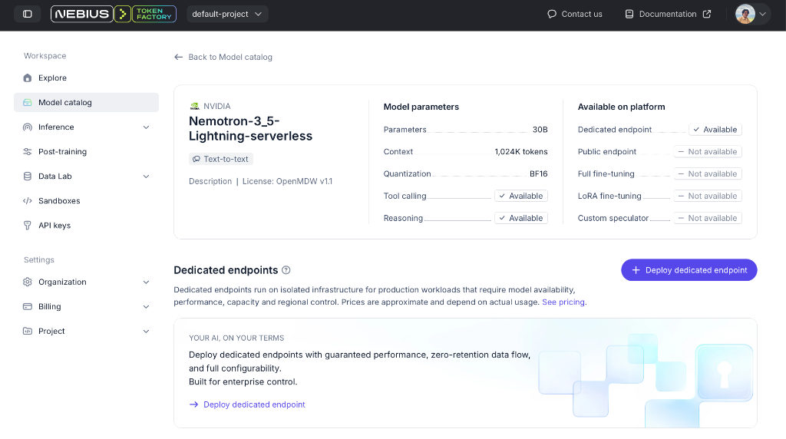
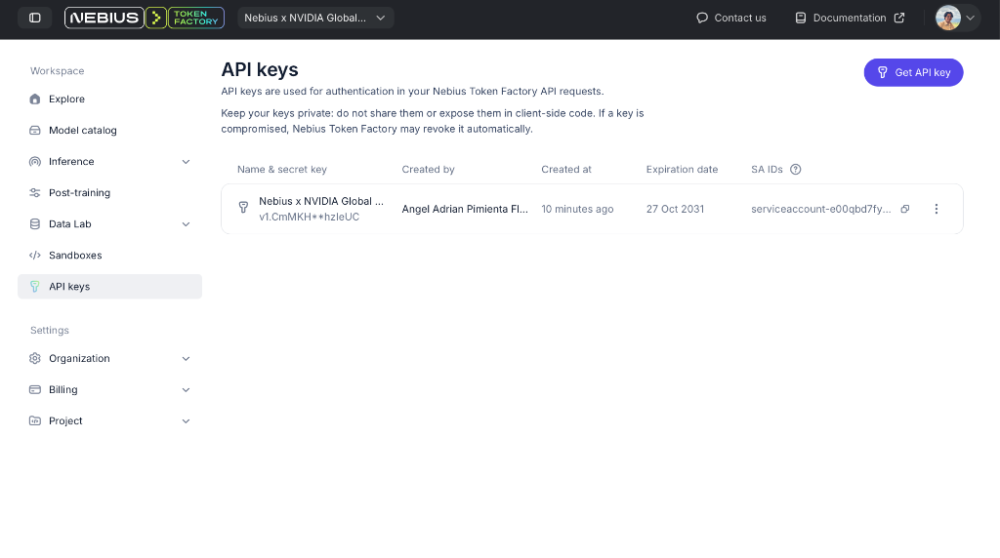
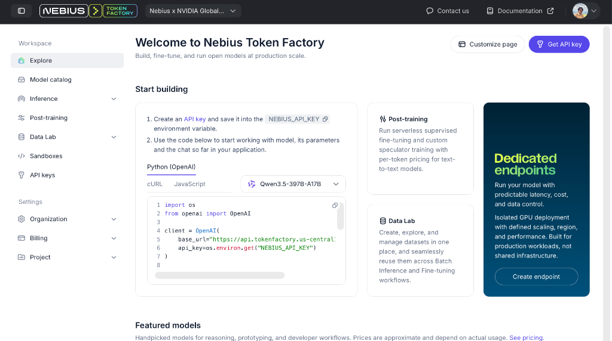

<p align="center">
  
</p>

<h1 align="center">VieWs</h1>

<p align="center">
  <strong>Ambient Generative Weather Atmosphere</strong><br>
  <em>Transforming emotional introspection into living procedural weather, generative soundscapes, and real-time sensory grounding.</em>
</p>

<p align="center">
  <a href="https://tokenfactory.nebius.com"></a>
  <a href="https://build.nvidia.com"></a>
  <a href="https://tavily.com"></a>
  <a href="https://swift.org"></a>
  <a href="https://developer.apple.com/ios/"></a>
</p>

<p align="center">
  
  
  
</p>

---

## Visual Showcase

<p align="center">
  
  
  
</p>

---

## Overview

**VieWs** is an ambient iOS and iPadOS application that turns human feelings into living, breathing atmospheres.

Instead of displaying standard meteorological forecasts, VieWs invites you to describe how you feel — whether in two words (*"quiet grief"*, *"sunlit optimism"*) or a paragraph of reflection (*"i really miss monterrey and its mountain sunsets"*). In a single rapid round-trip:

1. **NVIDIA Nemotron-3.5-Lightning** running on **Nebius Token Factory** translates the emotional nuances into physical weather parameters and mathematically validated color harmonies.
2. **Tavily AI Search** enriches natural language emotions with real-world atmospheric grounding when a place or memory of a destination is referenced.
3. **SpriteKit Procedural Particle Engine** simulates dynamic rain, snow, drifting fog, howling wind, and lightning storms at 60/120 FPS.
4. **5-Layer Real-Time DSP Audio Synthesizer** generates continuous procedural soundscapes with zero static looping audio files using custom `AVAudioSourceNode` math.

---

## Hackathon Track & Awards Alignment

### 1. Best Apps and Agents Track
* **Nebius Token Factory:** Integrates OpenAI-compatible high-throughput inference powered by **NVIDIA Nemotron-3.5-Lightning**. Response times are consistently under 1.5 seconds with low latency for real-time mobile scene transitions.
* **Nebius Serverless Endpoints (`proxy/`):** A production-ready, containerized FastAPI proxy deployed on Nebius Serverless Endpoints. Prevents mobile API key exposure, enforces strict prompt schemas, and provides IP-based rate limiting so judges can test the app without manual credential setup.
* **Deterministic Safety Net:** Client-side physical constraint validation guarantees that rain and snow never collide, lightning only strikes in stormy downpours, and UI text always achieves WCAG-compliant contrast.

### 2. $3,000 Best Use of Tavily Bonus Award
* **Real-Time Atmospheric Web Grounding:** When a user references a place or nostalgia (*"i really miss monterrey"*, *"autumn in Kyoto"*, *"walking through Chiapas"*), the client detects the location and queries Tavily AI Search for live conditions in under 0.5s.
* **Sensory Synthesis:** Tavily's live temperature, humidity, and sky conditions are blended into Nemotron's atmospheric prompt, grounding subjective emotion into objective physical reality.
* **Subtle Editorial Hint:** If grounded, an elegant subtitle (e.g. *monterrey is 24°c, overcast*) appears in the native palette accent without cluttering the screen.
* **Zero Quota Wastage:** Pure emotional introspections (*"quiet melancholy"*, *"exhausted after work"*) skip search, preserving search quota and avoiding false positive matches.

---

## System Architecture

```
┌────────────────────────────────────────────────────────┐
│               VieWs (iOS & iPadOS Native)              │
│   • SpriteKit Weather Particle Emitter Scene           │
│   • 5-Layer Procedural DSP Audio Synthesizer           │
│   • Swift 6 Strict Concurrency Architecture            │
└───────────────────────────┬────────────────────────────┘
                            │
              ┌─────────────┴─────────────┐
              │ (Mode A: Proxy)           │ (Mode B: Direct Dev)
              ▼                           ▼
┌───────────────────────────┐   ┌──────────────────────────┐
│  Nebius Serverless Proxy  │   │  Nebius Token Factory    │
│  (FastAPI on Nebius AI)   │   │  (Direct Bearer Auth)    │
│  • Zero key leakage       │   │  • Fast inference        │
│  • Rate limiting          │   │  • Reasoning tag filter  │
└─────────────┬─────────────┘   └─────────────┬────────────┘
              │                               │
              └───────────────┬───────────────┘
                              │
          ┌───────────────────┴───────────────────┐
          ▼                                       ▼
┌───────────────────────────┐   ┌──────────────────────────┐
│      Tavily AI Search     │   │  Nebius Token Factory    │
│  Live Web Weather Context │   │  NVIDIA Nemotron Models  │
│  (Sub-second retrieval)   │   │  (Nemotron-3.5-Lightning)│
└───────────────────────────┘   └──────────────────────────┘
```

---

## 5-Layer Procedural DSP Audio Engine

VieWs does not rely on looped audio recordings. Every sound is synthesized mathematically in real time via `AudioEngineService.swift`:

* **Precipitation:** Multi-oscillator drip resonator (randomized per-drop frequency 500–1600 Hz and surface tension Q) layered over filtered 6-pole pink noise.
* **Wind:** Three incommensurate LFOs driving continuous rate-wandering gusts (0.018 Hz cycle) connected to a swept Helmholtz resonance bandpass (40–70 Hz).
* **Snow:** Discrete brown noise integration with soft, low-frequency chimes.
* **Fog:** 0.03 Hz wandering sub-bass drone (55–75 Hz) with low-pass filtered breath waves.
* **Clear Sky:** Harmonically related singing bowl voices phasing continuously with stochastic crystal sparkles (800–3500 Hz).
* **Thunder:** Dynamic lightning strike audio with procedural sub-bass fallbacks.

---

## Quick Start & Setup

### Requirements
* Mac with macOS 15+ and Xcode 16+, or iPad with Swift Playgrounds 4+.
* Swift 6 language mode.

### Running with Nebius Serverless Proxy (Recommended)
1. Open `AI Weathers Nebius.swiftpm` in Xcode or Swift Playgrounds.
2. In `Secrets.swift`, set your deployed proxy URL:
   ```swift
   static let nebiusProxyURL = "https://<your-endpoint-id>.nebius.cloud"
   ```
3. Build and Run (`⌘R`).

### Running Direct with Token Factory & Tavily Keys
1. Open `AI Weathers Nebius.swiftpm/Secrets.swift`.
2. Add your **Nebius Token Factory API Key** and **Tavily API Key**:
   ```swift
   static let nebiusAPIKey = "your_nebius_token_factory_key"
   static let nebiusModel  = "nvidia/Nemotron-3_5-Lightning"
   static let tavilyAPIKey = "your_tavily_api_key"
   ```
3. Prevent accidental git commits of your keys:
   ```bash
   git update-index --skip-worktree "AI Weathers Nebius.swiftpm/Secrets.swift"
   ```
4. Build and Run (`⌘R`).

---

## Feedback on Nebius, NVIDIA & Tavily

* **Nebius Token Factory:** The OpenAI-compatible `/v1/chat/completions` endpoint made migrating from Apple on-device models remarkably smooth. The response speeds on **Nemotron-3.5-Lightning** were consistently fast (under 1.2s), providing instantaneous atmospheric transitions.
* **Nebius Serverless Endpoints:** Deploying containerized workloads on Nebius Serverless Endpoints with automatic public HTTPS URLs eliminates the security hazard of embedding cloud backend keys in distributed client binaries.
* **Tavily AI Search:** Tavily's structured search API with `include_answer: true` and `search_depth: basic` delivered lightning-fast response times (0.3s–2.0s) for live weather retrieval, making real-time environmental grounding viable on mobile devices.

---

## License & Credits

* Code released under the [MIT License](LICENSE).
* Audio assets and model attributions detailed in [`CREDITS.md`](CREDITS.md).
