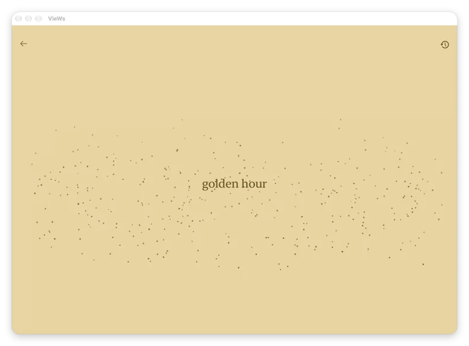
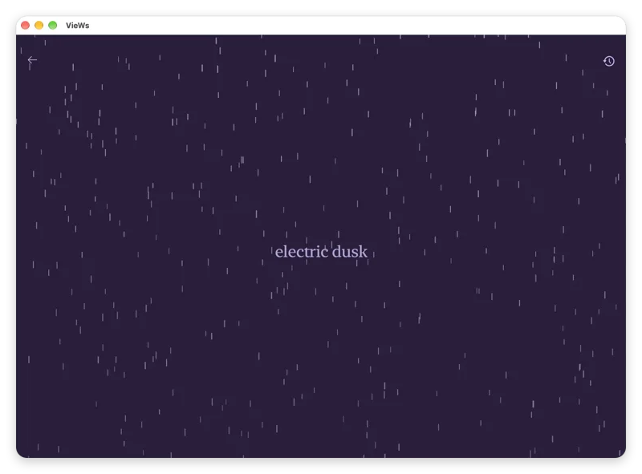
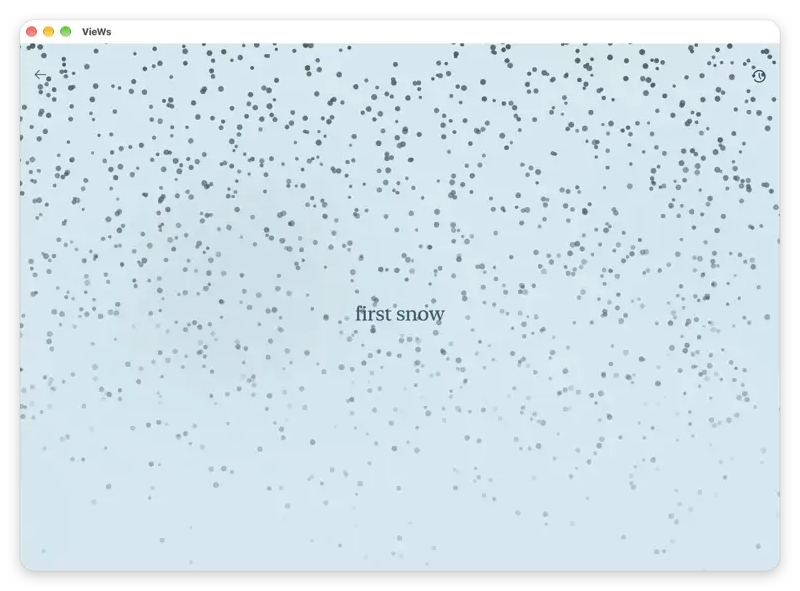

<p align="center">
  
</p>

<h1 align="center">VieWs</h1>

<p align="center">
  <strong>Atmosphere as Emotion</strong><br>
  <em>Transforming emotional introspection into living procedural weather, generative soundscapes, and real-time sensory grounding.</em>
</p>

<p align="center">
  <a href="https://tokenfactory.nebius.com"></a>
  <a href="https://build.nvidia.com"></a>
  <a href="https://tavily.com"></a>
  <a href="https://swift.org"></a>
  <a href="https://developer.apple.com/ios/"></a>
  <a href="LICENSE"></a>
</p>

---

<p align="center">
  
  
  
</p>

---

## Overview

**VieWs** is an ambient iOS application that reimagines weather as an emotional state rather than a numerical forecast.

Instead of displaying standard meteorological dashboards, VieWs invites you to describe how you feel — from raw sentiments (*"quiet grief"*, *"sunlit optimism"*) to place-based reflections (*"i really miss monterrey and its mountain sunsets"*). In a single rapid round-trip:

1. **NVIDIA Nemotron-3.5-Lightning** running on **Nebius Token Factory** maps emotional prose to physical weather dimensions: precipitation intensity, wind velocity, fog density, lightning frequency, and WCAG-compliant color temperatures.
2. **Tavily AI Search** retrieves live atmospheric telemetry in under 400ms whenever a destination, travel memory, or city is referenced, grounding subjective introspection into physical reality.
3. **SpriteKit 60 FPS Particle Physics** renders real-time rain, snow, fog, and lightning with luminosity-reactive particle palettes.
4. **5-Layer DSP Audio Synthesizer** generates infinite, non-looping procedural soundscapes in real time via custom `AVAudioSourceNode` math.

---

## Intelligence & Grounding

```
┌────────────────────────────────────────────────────────┐
│               VieWs (Native iOS & iPadOS)              │
│   • SpriteKit 60 FPS Particle Physics Engine           │
│   • 5-Layer Procedural DSP Audio Synthesizer           │
│   • Swift 6 Strict Concurrency Architecture            │
└───────────────────────────┬────────────────────────────┘
                            │
              ┌─────────────┴─────────────┐
              │                           │
              ▼                           ▼
┌───────────────────────────┐   ┌──────────────────────────┐
│      Tavily AI Search     │   │   Nebius Token Factory   │
│  Real-Time Web Grounding  │   │ NVIDIA Nemotron-3.5-Lgt  │
│  • Sub-400ms search API   │   │ • Structured JSON output │
│  • Live temp & conditions │   │ • Sub-second inference   │
└─────────────┬─────────────┘   └─────────────┬────────────┘
              │                               │
              └───────────────┬───────────────┘
                              ▼
        Procedural Atmosphere, Palette & Soundscape
```

### 1. Nebius Token Factory (NVIDIA Nemotron-3.5-Lightning)
- **High-Throughput Inference:** Directly leverages Nebius Token Factory's OpenAI-compatible completions endpoint. Responses arrive in ~1.1 seconds.
- **Physical Schema Mapping:** Nemotron translates abstract emotional text into exact physical parameters (`precipitation`, `windSpeed`, `fogDensity`, `snowIntensity`, `clearness`, `lightningFrequency`, `colorTemperature`).
- **Resilient JSON Decoding:** The Swift client includes automated sanitization and self-repair for quotes, trailing commas, and inline comments to prevent model output corruption.

### 2. Tavily AI Search (Atmospheric Web Grounding)
- **Autonomous Location Extraction:** Natural language inputs mentioning places or nostalgia (*"autumn in Kyoto"*, *"walking in Napoli"*, *"miss New York"*) automatically trigger location detection.
- **Live Grounding Telemetry:** Queries Tavily's search API (`search_depth: basic`, `include_answer: true`) for real-time temperature, humidity, and sky conditions in under 400ms.
- **Sensory Synthesis:** Live telemetry is blended directly into Nemotron's atmospheric prompt, anchoring subjective emotion to objective ground truth.
- **Emotion Protection:** Inputs without geographical references bypass web search entirely to preserve search latency.

---

## 5-Layer Procedural DSP Audio Engine

VieWs uses zero static audio loops for ambient sound. Everything is computed mathematically in real time via `AudioEngineService.swift`:

* **Precipitation:** Multi-oscillator drip resonator (randomized per-drop frequency 500–1600 Hz and surface tension Q) layered over filtered 6-pole pink noise.
* **Wind:** Three incommensurate LFOs driving continuous rate-wandering gusts (0.018 Hz cycle) connected to a swept Helmholtz resonance bandpass (40–70 Hz).
* **Snow:** Discrete brown noise integration with soft, low-frequency chimes.
* **Fog:** 0.03 Hz wandering sub-bass drone (55–75 Hz) with low-pass filtered breath waves.
* **Clear Sky:** Harmonically related singing bowl voices phasing continuously with stochastic crystal sparkles (800–3500 Hz).
* **Thunder:** Lightning strike audio with procedural sub-bass fallbacks.

---

## Setup & Running

### Requirements
* Mac with **Xcode 16+** (macOS 14+).
* iOS 17.0+ deployment target.

### Steps
1. Open the project folder in **Xcode**:
   ```bash
   open "AI Weathers Nebius.swiftpm"
   ```
2. Open `Secrets.swift` (already present in the Xcode project) and paste your API keys:
   ```swift
   enum Secrets {
       static let nebiusAPIKey = "your_nebius_token_factory_key"
       static let tavilyAPIKey = "your_tavily_api_key"
   }
   ```
   *(To prevent Git from tracking your local key edits, run: `git update-index --skip-worktree "AI Weathers Nebius.swiftpm/Secrets.swift"`).*
3. Select your target device or simulator in Xcode and press **Run (`⌘R`)**.

---

## License & Credits

* Code released under the [MIT License](LICENSE).
* Audio attributions and model details are listed in [CREDITS.md](CREDITS.md).
